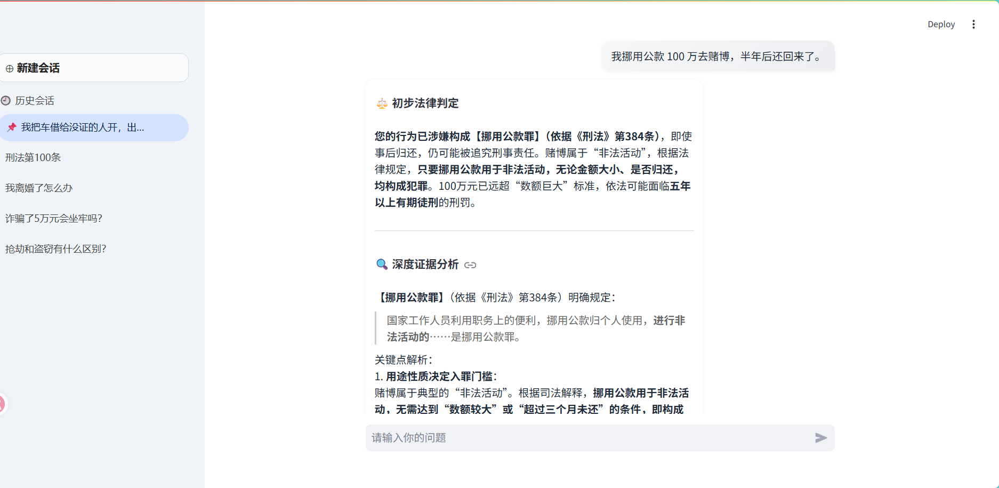

# 现代知识库（RAG + 可插拔检索 + 来源引用）

本项目从法律问答原型逐步改造为通用中文知识库，基于 Streamlit 提供上传与对话界面。当前已完成多格式解析、结构切块、向量库对比及可选检索策略，正在接入通用回答、来源引用和拒答。分节点设计与当前限制见[改造文档](docs/README.md)。下方旧上传流程和历史截图尚未全部迁移。

## 1. 项目能力

- 文档入库：法律文本预处理、分块、向量化并持久化到 Chroma。
- 混合召回：向量检索 + BM25 并行召回，通过 RRF 融合后返回证据。
- 生成回答：通用知识库提示词、流式回答、引用编号与真实来源映射；空资料直接说明不足。
- 会话管理：会话列表、新建、置顶、删除、持久化历史。
- 记忆压缩：滑动窗口 + 摘要压缩 + Token 预算裁剪。
- 可观测性：可开启压缩调试日志，直接在控制台查看压缩过程。

当前模型配置：

- 主回答模型：`qwen3.8-max`，关闭思考；模型池支持 `glm-5.3-flash` 智谱备用，填写独立密钥并显式开启后生效。见[回答模型池设计与使用](docs/回答模型池设计与使用.md)。真实问答质量评测尚未完成。
- 会话摘要模型：`glm-5.3-flash`，low档；只用于当前会话，跨会话记忆暂不启用
- 向量模型：`text-embedding-v4`

预览：



## 2. 目录结构

```text
KnowledgeBase-RAG-LLM-System/
├── app/
│   ├── streamlit_chat.py            # 对话页面
│   └── streamlit_upload.py          # 文档上传与入库页面
├── core/
│   └── config.py                    # 全局配置（检索/模型/记忆压缩）
├── generation/
│   └── rag_service.py               # RAG 主链路（检索->提示词->生成）
├── retrieval/
│   └── hybrid_retriever.py          # 向量 + BM25 + RRF
├── ingestion/
│   ├── legal_preprocess.py          # 文本预处理
│   ├── legal_chunker.py             # 分块与元数据
│   └── ingest_service.py            # 入库服务
├── infra/
│   └── vector_store.py              # 向量库封装
├── memory/
│   └── history_store.py             # 会话持久化与压缩策略
├── test/
│   ├── test_memory_compression.py   # 记忆压缩单元测试
│   └── validate_memory_compression.py # 压缩行为演示脚本
├── data/                            # 原始法律文本与知识文件
├── doc/                             # 方案、流程图、总结文档
├── chroma_db/                       # 运行后生成：向量库
├── chat_history/                    # 运行后生成：会话历史
├── requirements.txt
└── README.md
```

## 3. 环境准备

建议 Python 3.10 或 3.11。

### 3.1 使用 uv（推荐）

```powershell
uv venv --python 3.11
.\.venv\Scripts\Activate.ps1
uv pip install -r requirements.txt
```

### 3.2 使用 pip

```powershell
python -m venv .venv
.\.venv\Scripts\Activate.ps1
pip install -r requirements.txt
```

## 4. 环境变量

先复制环境变量模板：

```powershell
Copy-Item .env.example .env
```

然后在项目根目录的 `.env` 中填写真实密钥：

```env
DASHSCOPE_API_KEY=sk-你的真实密钥
DASHSCOPE_BASE_URL=https://dashscope.aliyuncs.com/compatible-mode/v1
ANONYMIZED_TELEMETRY=False
```

## 5. 启动方式

在项目根目录执行。

### 5.1 启动上传页面（先入库）

```powershell
.\.venv\Scripts\python.exe -m streamlit run app/streamlit_upload.py
```

或：

```powershell
uv run streamlit run app/streamlit_upload.py
```

### 5.2 启动聊天页面

```powershell
.\.venv\Scripts\python.exe -m streamlit run app/streamlit_chat.py
```

或：

```powershell
uv run streamlit run app/streamlit_chat.py
```

如果虚拟环境已激活，可简写：

```powershell
streamlit run app/streamlit_upload.py
streamlit run app/streamlit_chat.py
```

## 6. 关键配置说明

配置文件：`core/config.py`

### 6.1 检索相关

- `hybrid_vector_k`: 向量召回候选数
- `hybrid_bm25_k`: BM25 召回候选数
- `hybrid_final_k`: 融合后最终证据数，当前默认10块；向量与BM25仍各召回20块
- `hybrid_rrf_k`: RRF 融合参数

### 6.2 记忆压缩相关

- `memory_history_max_tokens`: 历史视图总预算，当前32768估算Token，包含摘要与保留的原文
- `memory_summary_max_tokens`: 摘要上限，当前4096估算Token，不要求写满
- `memory_compression_trigger`: 当前为 `tokens`，预算内保留原文，超预算才摘要
- `memory_keep_recent_rounds` / `memory_summary_trigger_rounds`: 旧轮次策略兼容参数，当前3/5，不限制正常Token策略的原文保留轮数
- `memory_summary_max_chars`: 旧字符上限兼容参数，当前Token模式不使用该限制
- `memory_summary_enabled`: 是否启用摘要
- `memory_summary_tag`: 内部摘要标识
- `memory_compression_debug`: 是否打印压缩日志（当前开启）

## 7. 记忆压缩策略（当前实现）

`memory/file_history.py` 保存完整原始对话，`memory/session_context.py` 构建受预算约束的模型视图，压缩不覆盖原文。预算内不提前摘要；超预算后为摘要预留空间，尽量保留近期完整轮次，使用已配置GLM、low档增量更新较早内容。

摘要失败明确标记降级，不将截断当作成功；最新一轮超过预算时明确报错。用户要求忘记的具体旧值不再带入新摘要，但不等于物理删除完整聊天记录。跨会话记忆关闭。

可选 `QUERY_RESOLUTION_STRATEGY=glm_history` 在检索前补全历史指代，有歧义则先澄清。默认 `original` 不变，不增加消歧模型请求。详见[节点8说明](docs/08-记忆与会话压缩.md)及[插件对照](docs/历史查询消歧插件与对照测试.md)。

## 8. 测试与验证

### 8.1 单元测试

```powershell
python -m unittest discover -s test -p "test_memory_compression.py" -v
```

### 8.2 行为演示（打印压缩行为）

```powershell
python test/validate_memory_compression.py
```


## 9. 免责声明

本项目输出仅用于学习与技术验证，不构成正式法律意见。涉及真实法律事务请咨询持证律师。
